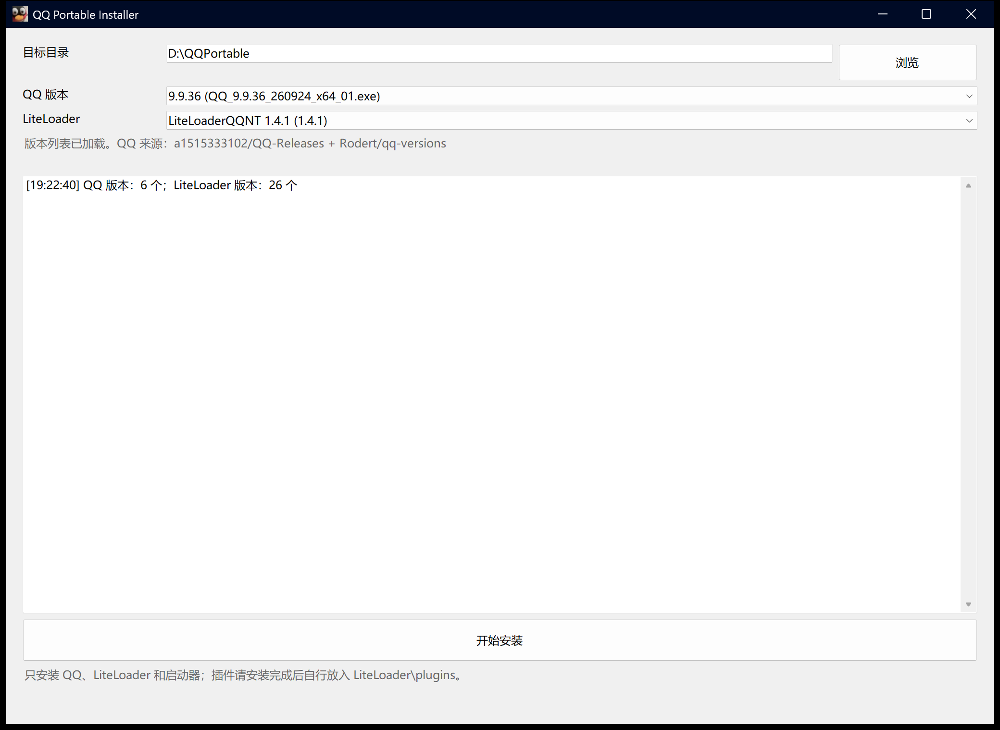
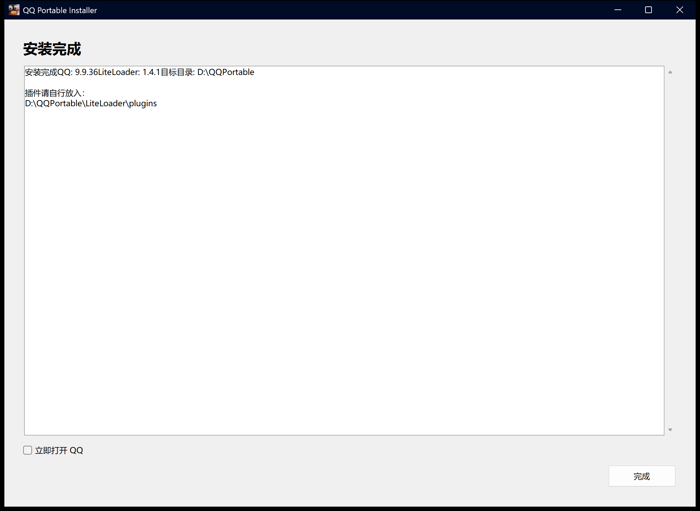

<p align="center">
  
</p>

# QQ Portable Suite

Windows 10/11 x64 使用的 QQ 便携安装器和启动器，集成 LiteLoaderQQNT 与 NapCat 注入支持。

安装后 QQ 程序、LiteLoader 和启动器都在同一个目录里，不创建快捷方式，不需要单独安装 .NET。

## 系统要求

- Windows 10 或 Windows 11，x64。
- 安装和更新版本列表需要访问 GitHub。
- 目标目录必须是空目录。

## 安装

1. 打开 [Releases](https://github.com/4o4E/QQPortable/releases) 下载最新版 `QQPortable.Installer.exe`。
2. 运行安装器，选择一个新的空目录，例如 `D:\QQPortable`。
3. 选择 QQ 版本和 LiteLoader 版本。
4. 点击“开始安装”，等待下载和解压完成。
5. 安装完成后点击“完成”。

安装器不会覆盖已有目录，也不会创建桌面快捷方式。第一次启动时，QQ 可能需要重新登录。

## 界面截图

安装器主界面：



安装完成页面：



## 启动

打开安装目录，运行：

```text
QQPortable.exe
```

启动器会检查本次便携目录的 QQ 是否已经在运行；已运行时会激活现有窗口，不会启动第二份。

`Launcher\NapCatWinBootMain.exe` 是 NapCat 提供的启动器，负责启动 QQ 并加载注入文件，不是 QQ 主程序本身。

关闭 QQ 主窗口默认只是隐藏到托盘，QQ 和 NapCat 提供的启动器 `NapCatWinBootMain.exe` 仍在后台运行。需要完全退出时，从 QQ 托盘菜单选择退出；退出后对应的 `NapCatWinBootMain.exe` 会自动结束。

## 安装后的目录

```text
<安装目录>\
  QQPortable.exe         启动器
  QQ\                    官方 QQ 程序
  LiteLoader\            LiteLoader 本体、插件和数据
  Launcher\              NapCat 注入文件和运行时配置
```

`Launcher` 目录由安装器生成，不需要手动修改。

## 插件

安装完成后 `LiteLoader\plugins` 是空的。插件由用户自行安装和配置，安装器不会附带或启用插件。

把插件目录放到：

```text
<安装目录>\LiteLoader\plugins\<插件目录>
```

然后完全退出并重新启动 QQ。

## 命令行安装

图形界面之外也可以直接用命令行安装：

```powershell
QQPortable.Installer.exe --install --target D:\QQPortable `
  [--qq-version 9.9.36] [--liteloader-version 1.4.1] `
  [--qq-installer <本地安装包>] [--liteloader-directory <本地目录>] [--force]
```

`--qq-installer` 和 `--liteloader-directory` 适合离线安装或使用本地已经下载的文件。

## 便携范围

便携目录只包含程序文件。QQ 的登录状态、聊天记录、缓存和用户数据仍保存在：

```text
%APPDATA%\QQ
%LOCALAPPDATA%\QQ
```

因此删除便携目录不会删除聊天记录。更换电脑时需要另外迁移这些数据。

## 注意事项

- 目标目录已有文件时安装器会拒绝安装，请换一个空目录。
- 版本列表需要联网。GitHub API 暂时不可用时会自动尝试发布页；如果列表仍然加载失败，请检查网络或代理。
- 下载的安装包没有代码签名，Windows 可能显示安全提示。
- 安装器只安装程序文件，不安装插件，也不修改 QQ 的聊天数据。
